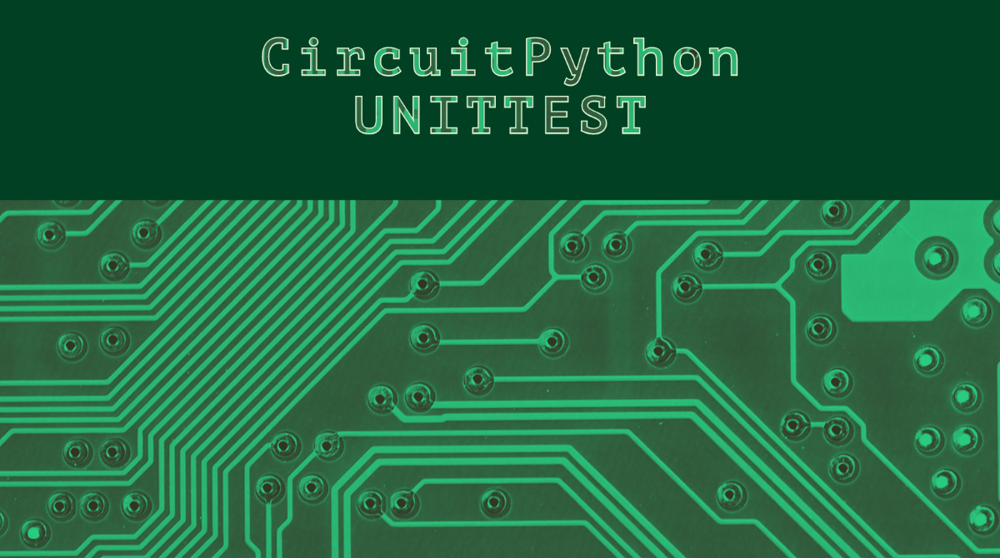

# CircuitPython Unittest
A repo that provides the MP-Lib unittest.py to CircuitPython to allow makers to take full advantage of Python's unittest within CircuitPython.

<br>

# Installation
```bash
git clone https://github.com/mytechnotalent/CircuitPython_Unittest.git
```

<br>

# Copy Files To CircuitPython Device
```bash
unittest.py
code.py
test_code.py
tests/test_code.py
```
unittest.py could copied to the lib folder instead of the root.

<br>

# 24/7 Community Of Support
If you have any questions regarding this app or implementing your own version of this app please visit us in the CircuitPython Discord channel [HERE](https://discord.com/invite/5FBsBHU) and visit the `help-with-circuitpython` room.

<br>

# Run Tests in REPL
```bash
import unittest
unittest.main('test_code')
unittest.main('tests.test_code')
```

# License
[Apache License, Version 2.0](https://www.apache.org/licenses/LICENSE-2.0)
